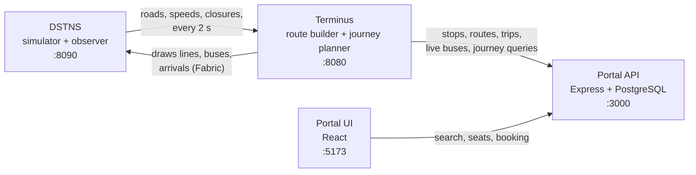

# Terminus

A public bus route planner built as three programs that work together. A traffic
simulator provides a city and its live road conditions. A route builder and journey
planner designs a bus network on that city and answers passenger questions. A
ticketing portal lets passengers search, pick a seat, pay a fare and hold a digital
ticket, and lets a conductor board them.

This site is the user guide for running and using all three together.

## The three parts

| Part | What it does | Repository | Language | Default port |
|---|---|---|---|---|
| **DSTNS** | Deterministic traffic simulator. Compiles an OpenStreetMap district into a road graph and advances traffic, weather and signals on a virtual 24-hour clock. Has a browser observer. | [`varunkarthic/DSTNS`](https://github.com/varunkarthic/DSTNS) ([docs](https://dstns.readthedocs.io/v3)) | C++20, Rust launcher | 8090 |
| **Terminus** | Route builder (Algorithm 1) and journey planner (Algorithm 2). Reads the simulator, plans bus lines, serves a JSON API and a dashboard, and draws its lines and buses inside the DSTNS observer. | [`inevitable-lettus/Terminus`](https://github.com/inevitable-lettus/Terminus) | Java 21 | 8080 |
| **Ticketing portal** | Passenger search, seat locking, booking, QR tickets, booking history and the conductor page. | [`CSC210-Monsoon2026/group-08-public-bus-route-planner`](https://github.com/CSC210-Monsoon2026/group-08-public-bus-route-planner) | Node, Express, PostgreSQL, React | API 3000, UI 5173 |

## How they connect

- **DSTNS to Terminus.** Terminus reads the simulator's roads and speeds and
  re-reads them every 2 seconds. Terminus never changes the simulation. A person
  closes a road in the DSTNS observer and Terminus reacts.
- **Terminus to DSTNS.** Terminus joins DSTNS as a Fabric application, so the
  observer can show its bus lines, buses and next arrivals on the map.
- **Terminus to the portal.** The portal copies Terminus's stops, routes and trips
  into its own database every 2 seconds, and asks Terminus for a journey on every
  search.
- **Portal UI to portal API.** The React app talks only to the portal API.

## Where to start

-   **Run everything**

    ---

    Start the simulator, Terminus and the portal and book a ticket.

    [Quick start](getting-started/quick-start.md)

-   **Check your machine**

    ---

    What each part needs installed.

    [Requirements](getting-started/requirements.md)

-   **Use Terminus**

    ---

    The `./bus` commands, the local API and the dashboard.

    [User guide](guide/index.md)

-   **Something broke**

    ---

    Port clashes, 409 errors, a stalled map download.

    [Troubleshooting](troubleshooting.md)

## Status

The algorithm module is built and tested against DSTNS. The portal supports search,
booking of single-bus journeys, tickets and the conductor page. Known gaps, such as
a live arrival countdown in the portal and booking journeys with a change of bus,
are listed in [Known limitations](known-limitations.md).
