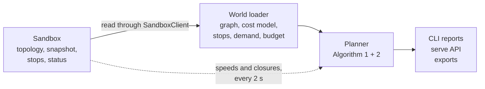

# The sandbox interface

A **sandbox** is whatever supplies Terminus with a city: its road graph, how fast
traffic is moving on each road right now, and, optionally, where people want to go. This
page lists exactly what Terminus reads, what is required, and what each field is for.

!!! warning "The interface as it is today"
    There is no neutral input layer yet. Terminus reads DSTNS's HTTP API directly, and
    the field names and endpoints below are DSTNS's. Terminus's core still uses DSTNS's
    data types (`client.TopologyData`, `client.SnapshotData` and the `model` records).
    Another sandbox therefore needs an **adapter**, and none exists. The decoupling is
    tracked in epic [#17](https://github.com/inevitable-lettus/Terminus/issues/17):
    [#28](https://github.com/inevitable-lettus/Terminus/issues/28) (neutral model),
    [#29](https://github.com/inevitable-lettus/Terminus/issues/29) (input interfaces),
    [#30](https://github.com/inevitable-lettus/Terminus/issues/30) (demand and stops) and
    [#31](https://github.com/inevitable-lettus/Terminus/issues/31) (DSTNS as an optional
    adapter). See [Connect your own sandbox](connect-your-own.md).

## What a sandbox must provide

| Need | Why Terminus needs it |
|---|---|
| A directed road graph: junctions with **positions**, roads with **from**, **to**, **length** and **free speed** | The map every search runs on |
| For each road, the reverse twin (or none) | To tell a two-way street from a one-way one |
| For each road, a live **effective speed** and a **closed** flag | The cost of driving it now |
| Which reverse edges are **fabricated** (one-way streets), if the sandbox publishes a reverse for every street | So no search drives the wrong way |
| A **run identity** and the current **simulated time** | To re-plan when a new run starts, and to build a timetable and place buses |
| Ids that are **dense**: junction and road ids `0` to `count - 1`, each listed once | The graph is built from them; out-of-range or duplicate ids are errors |

## What a sandbox may provide

| Optional | If absent |
|---|---|
| Junctions flagged as **bus stops** | Terminus adds stops itself so that no junction is farther than the [maximum gap](../concepts/demand-and-stops.md) from one |
| **Demand points** (features) and their active **intensities** | Demand falls back to buildings, then to uniform |
| **Building** fields on junctions and a per-junction building effect | Used only by the buildings fallback |
| **Stop names** | Stops are named `stop_<junction>` |
| City name and country | Left out of report headers |
| Road class and congestion | Shown in the dashboard only |

Weather, signals, lanes, vehicle counts, junction degree and OpenStreetMap ids are
carried by DSTNS's records but are **not read** by the planner.

## What Terminus reads today

All paths are DSTNS's, under `/api/v1` and wrapped in an `{ok, data}` envelope, apart
from `/health`. Wire names are `snake_case`.

| Endpoint | Fields Terminus uses |
|---|---|
| `GET /api/v1/view/topology` | `nodes[]`: `id`, position (`lat`, `lon`, `x_m`, `y_m`), `bus_stop`, and the building fields (`building`, `building_impact`, `building_radius_m`). `edges[]`: `id`, `from`, `to`, `reverse_twin` (`-1` for none), `length_m`, `free_speed_mps`, and optionally `synthetic_reverse`. `features[]`: `id`, `name`, `category`, `position`, `anchor_node`, `demand_type`. `location`: `city`, `country` |
| `GET /api/v1/view/snapshot` | `edges[]`: `id`, `closed`, `effective_speed_mps` (and `congestion` for the dashboard). `nodes[]`: `building_effect`. `demand[]`: `feature_id`, `kind`, `multiplier`, `radius_m`, `active`. Entries of kind `bus_stop` are skipped. Each edge and node must be listed exactly once |
| `GET /api/v1/view/edges?offset=&limit=` | Paged, 1000 at a time. Read **only** when the topology does not say which edges are fabricated reverses (older DSTNS). `source.synthetic_reverse` |
| `GET /api/v1/view/stops` | Stop names, matched through each place's `anchor_node`. Optional |
| `GET /health` | The server's lifecycle state; `./bus` waits for it to be ready. Not under `/api/v1` |
| `GET /api/v1/playback/status` | `run_id`, `global_seed` and `clock.simulated_current_time` |

Parsed but not used by any code: `topology_revision`, `bounds`, a demand entry's
`baseline`. `graph_hash` appears in reports and exports only.

### Required fields

The parser refuses a response without these.

| Record | Required |
|---|---|
| Road | `id`, `from`, `to`, `reverse_twin`, `length_m`, `free_speed_mps` |
| Road state | `id`, `closed`, `effective_speed_mps` |
| Junction | Nothing is annotated as required, but `id` and a position are needed in practice: ids are checked for range and uniqueness and the position is read |

Lengths and speeds must be finite and not negative.

### Both kinds of position

`x_m` and `y_m` (metres) drive everything Terminus computes. `lat` and `lon` are used
only for output. A sandbox must supply both, and they must agree.

### Demand points

Demand points need a feature id that joins a topology feature to its snapshot demand
entry. Catchment demand is used when **both** features and demand are present, and
neither counts without the other.

## What Terminus can change

Reads never change the sandbox. These calls are made only when you ask:

| Call | When |
|---|---|
| `POST /api/v1/playback/pause`, then `POST /api/v1/playback/seek` with `{"target_time": "...", "play": false}` | With `--time`, with `POST /api/reload` carrying a time and `seek: true`, and when starting a run |
| `POST /api/v1/playback/start` (carries the operator token) and `POST /api/v1/playback/stop` | Only with `--start` or `--seed` |
| `PUT /api/v1/control/edges/{id}` with `{"closed": true}` | Used by the live tests to close and reopen a road. Not used by `./bus` |

`playback/stop` is sent without the operator token. Whether DSTNS accepts that today
was not verified.

DSTNS also offers a **Fabric** link that lets a program draw in its observer and read
its events. It is specific to DSTNS and is documented under
[the DSTNS integration](../integrations/dstns/index.md).

## How the pieces fit together

The loader builds one `World` from a topology and a snapshot. There is a single copy of
that pipeline, used by the command line, the server and the live tests, so every path
plans from the same code.
